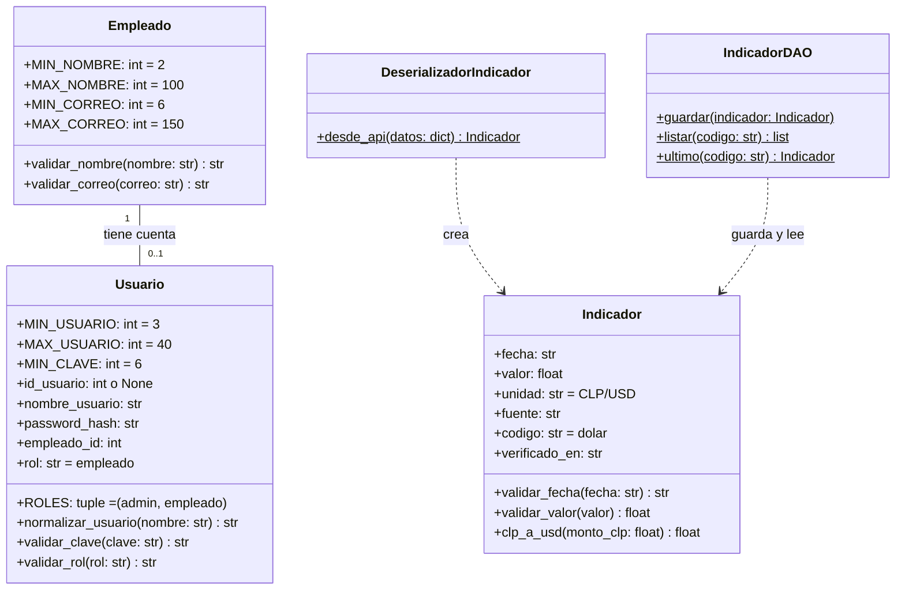

# UML 

Las constantes pertenecen a la clase
y los métodos de validación son `@classmethod`.

Tabla nueva: `usuario(id_usuario PK, nombre_usuario UNIQUE, password_hash,
empleado_id FK UNIQUE NOT NULL, rol CHECK admin|empleado)` que apunta a
`empleado(id_empleado)`.
Las constantes `MIN_*` y `MAX_*` no son columnas de la base de datos.

Tabla nueva: `indicador_api(id_indicador PK, fuente, codigo, fecha, valor, unidad,
verificado_en, UNIQUE(fuente, codigo, fecha))`.

Módulos de servicio (sin clase): `permisos` (`exigir_sesion`, `exigir_admin`, `requiere_admin`),
`mi_cuenta`, `api_dolar` (`obtener_datos`, `extraer_primero`) e `indicadores`
(`consultar_indicador`, `buscar_respaldo`, `obtener_historial`).

# Sugerencia de la IA en re-estructurar UML