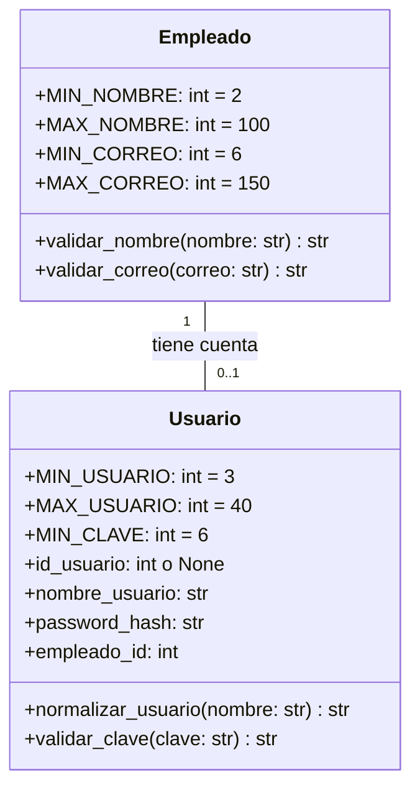

# Cambios al UML (Unidad 3)

Hay que actualizar `EcoTech_UML.pdf` con estos cambios. Las constantes pertenecen a la clase
y los métodos de validación son `@classmethod`.

Tabla nueva: `usuario(id_usuario PK, nombre_usuario UNIQUE, password_hash,
empleado_id FK UNIQUE NOT NULL)` que apunta a `empleado(id_empleado)`.
Las constantes `MIN_*` y `MAX_*` no son columnas de la base de datos.
